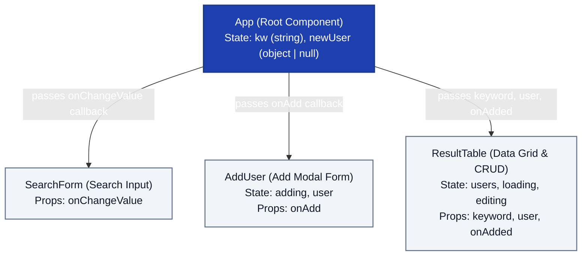
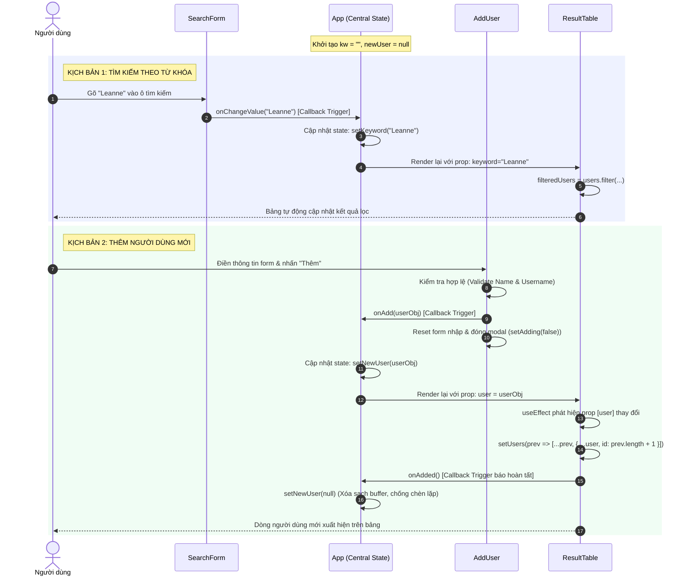

# BÁO CÁO KỸ THUẬT & GIẢI TRÌNH KIẾN TRÚC REACT CRUD
## HỌC PHẦN IT4409 — CÔNG NGHỆ WEB VÀ DỊCH VỤ TRỰC TUYẾN (ASSIGNMENT 06)

---

### THÔNG TIN SINH VIÊN
- **Họ và tên:** Hà Tuấn Dũng
- **Mã số sinh viên (MSSV):** `20235299`
- **Lớp học phần:** IT4409 — Lập trình Web | Viện CNTT&TT — Đại học Bách Khoa Hà Nội (HUST)
- **GitHub Repository:** [https://github.com/Dngk1105/WEB-Asignment](https://github.com/Dngk1105/WEB-Asignment)
- **Live Deployment:** [https://dngk2408.id.vn/assignment-06/](https://dngk2408.id.vn/assignment-06/)
- **Đường dẫn ứng dụng:** [assignment-06/bai-tap-1/index.html](./bai-tap-1/index.html)

---

## MỤC LỤC
1. [Yêu cầu 1: Sơ đồ Component Tree & Vai trò từng Component](#1-sơ-đồ-component-tree--vai-trò-từng-component)
   - 1.1 Sơ đồ phân cấp Component (Mermaid Diagram & ASCII Tree)
   - 1.2 Vai trò, trách nhiệm và phạm vi chi tiết của từng Component
2. [Yêu cầu 2: Cơ chế Nâng trạng thái (State Lifting) & Sơ đồ Luồng Dữ liệu](#2-cơ-chế-nâng-trạng-thái-state-lifting--sơ-đồ-luồng-dữ-liệu)
   - 2.1 Sơ đồ luồng dữ liệu hai chiều Props-Callback (Mermaid & ASCII)
   - 2.2 Phân tích chuyên sâu: Tại sao `kw` và `newUser` BẮT BUỘC đặt tại `App`?
     - *Nguyên lý 1: Luồng dữ liệu một chiều (One-Way Data Flow)*
     - *Nguyên lý 2: Giao tiếp giữa các Component ngang hàng (Sibling Communication)*
     - *Nguyên lý 3: Nguồn chân lý duy nhất (Single Source of Truth - SSOT)*
     - *Nguyên lý 4: Đảo ngược điều khiển (Inversion of Control - IoC) & Giảm phụ thuộc*
   - 2.3 Chu trình vận hành thực tế của dữ liệu (Data Life-Cycle Walkthrough)
3. [Yêu cầu 3: Bảng Mô tả Chi tiết Toàn bộ Props trong Ứng dụng](#3-bảng-mô-tả-chi-tiết-toàn-bộ-props-trong-ứng-dụng)
   - 3.1 Bảng tổng hợp Props
   - 3.2 Phân tích ngữ nghĩa và hoạt động của từng Prop
4. [Yêu cầu 4: Phân tích Chuyên sâu các Lỗi Thực tế & Biện pháp Khắc phục Chuẩn](#4-phân-tích-chuyên-sâu-các-lỗi-thực-tế--biện-pháp-khắc-phục-chuẩn)
   - 4.1 Lỗi 1: `onClick={setAdding(false)}` — Infinite Re-render Loop ("Too many re-renders")
   - 4.2 Lỗi 2: Tham chiếu nông (Shallow Copy Mutation Bug) trên Object lồng nhau (`address`)
   - 4.3 Lỗi 3: Thiếu hoặc dùng sai thuộc tính `key` trong danh sách `Array.map()`
5. [Tổng kết Kiến trúc & Đánh giá Ứng dụng](#5-tổng-kết-kiến-trúc--đánh-giá-ứng-dụng)

---

## 1. SƠ ĐỒ COMPONENT TREE & VAI TRÒ TỪNG COMPONENT

### 1.1 Sơ đồ phân cấp Component

Hệ thống được thiết kế theo mô hình phân rã hướng chức năng (Functional Component Deconstruction), bao gồm 1 Component gốc điều phối (`App`) và 3 Sub-components đảm nhiệm các phân vùng giao diện chuyên biệt:

#### Sơ đồ trực quan (Mermaid Diagram):


#### Sơ đồ ASCII Tree:
```text
[App] (Root Orchestrator - Quản lý trạng thái chia sẻ toàn cục)
 │
 ├── [SearchForm] (Controlled Input - Tiếp nhận từ khóa tìm kiếm)
 │     └── <input type="text">
 │
 ├── [AddUser] (Creation Portal - Quản lý nhập liệu & Modal thêm mới)
 │     ├── <button class="btn-primary"> (Mở Modal Thêm mới)
 │     └── [Modal: Form Thêm] (Hiển thị có điều kiện khi adding = true)
 │           ├── Inputs: name, username, email, phone, website, street, suite, city
 │           └── Actions: handleAdd() (Validate & Submit) | Hủy
 │
 └── [ResultTable] (Data Consumer & CRUD Engine - Hiển thị, Lọc, Sửa, Xóa)
       ├── [Loading State / Empty State] (Hiển thị khi đang fetch hoặc mảng rỗng)
       ├── [Table Header & Body] (Render danh sách qua Array.map)
       │     └── <tr> (Các dòng dữ liệu kèm Action Buttons: Sửa, Xóa)
       └── [Modal: Form Chỉnh Sửa] (Hiển thị có điều kiện khi editing != null)
             ├── Inputs: Controlled theo editing.*
             └── Actions: saveUser() (Deep Copy Update) | Hủy
```

---

### 1.2 Vai trò, trách nhiệm và phạm vi chi tiết của từng Component

| Component | Vị trí phân cấp | Trách nhiệm chính (Single Responsibility Principle) | Trạng thái nội bộ (Internal State) | Props nhận từ bên ngoài |
| :--- | :--- | :--- | :--- | :--- |
| **`App`** | Root (Cha cao nhất) | **Bộ điều phối trung tâm (Central Orchestrator):**<br>- Nắm giữ dữ liệu dùng chung (`kw`, `newUser`).<br>- Khởi tạo cây giao diện, kết nối các component con thông qua cơ chế State Lifting.<br>- Cung cấp các callback (`setKeyword`, `setNewUser`, `() => setNewUser(null)`) cho các con giao tiếp gián tiếp với nhau. | - `kw`: chuỗi tìm kiếm hiện tại.<br>- `newUser`: bản ghi người dùng mới vừa tạo (hoặc `null`). | *Không có (Được render trực tiếp vào DOM `root`)* |
| **`SearchForm`** | Con của `App` | **Thu thập tín hiệu tìm kiếm (Filter Signal Emitter):**<br>- Hiển thị thanh nhập liệu tìm kiếm (Input box).<br>- Lắng nghe sự kiện `onChange` từ bàn phím người dùng.<br>- Bắn tín hiệu giá trị tìm kiếm ngay lập tức lên `App` qua callback `onChangeValue`.<br>- Hoàn toàn không giữ state dữ liệu, đóng vai trò là Stateless / Controlled Presentation Component. | *Không có state riêng.* | - `onChangeValue`: Hàm callback `(val) => void` do `App` truyền xuống. |
| **`AddUser`** | Con của `App` | **Quản lý biểu mẫu thêm mới (Data Intake Portal):**<br>- Điều khiển trạng thái đóng/mở của hộp thoại modal (`adding`).<br>- Quản lý dữ liệu form đang nhập trong local state `user` (bao gồm cấu trúc lồng nhau `address`).<br>- Thực hiện kiểm tra tính hợp lệ (Validation): bắt buộc phải có `name` và `username`.<br>- Gửi dữ liệu người dùng mới lên `App` thông qua prop callback `onAdd`.<br>- Tự reset form về trạng thái trống sau khi gửi thành công. | - `adding`: `boolean` (ẩn/hiện modal).<br>- `user`: `object` mẫu người dùng mới (chứa các trường phẳng và lồng `address`). | - `onAdd`: Hàm callback `(newUserObj) => void` do `App` truyền xuống. |
| **`ResultTable`** | Con của `App` | **Trung tâm xử lý dữ liệu (Data Grid & CRUD Operations):**<br>- Khởi tạo và nạp dữ liệu ban đầu từ REST API (`jsonplaceholder.typicode.com/users`) bằng `useEffect`.<br>- Lắng nghe thay đổi của prop `user` để chèn bản ghi mới vào danh sách `users`, sau đó gọi callback `onAdded()` để báo cho `App` reset buffer.<br>- Thực hiện tính toán phái sinh (Derived State): Lọc danh sách `filteredUsers` dựa trên prop `keyword`.<br>- Quản lý hộp thoại chỉnh sửa (Edit Modal) với kỹ thuật Deep Copy đối tượng lồng nhau.<br>- Cập nhật bản ghi sau khi sửa (`saveUser`) theo nguyên tắc bất biến (Immutability).<br>- Xóa người dùng (`removeUser`) bằng `Array.filter()`. | - `users`: mảng toàn bộ người dùng.<br>- `loading`: `boolean` (trạng thái tải API ban đầu).<br>- `editing`: `object | null` (bản ghi đang được sửa trong modal). | - `keyword`: chuỗi lọc từ `App`.<br>- `user`: bản ghi mới cần bổ sung từ `App`.<br>- `onAdded`: Hàm callback báo đã nạp xong từ `App`. |

---

## 2. CƠ CHẾ NÂNG TRẠNG THÁI (STATE LIFTING) & SƠ ĐỒ LUỒNG DỮ LIỆU

### 2.1 Sơ đồ luồng dữ liệu hai chiều Props-Callback

Trong React, luồng dữ liệu thuần túy là **đơn hướng từ trên xuống dưới (Top-Down / One-Way Data Flow)**. Để các component ngang hàng (anh-em ruột) như `SearchForm`, `AddUser` có thể tác động đến `ResultTable`, ta bắt buộc phải áp dụng mẫu hình **State Lifting (Nâng trạng thái lên cha chung gần nhất)**.

#### Sơ đồ luồng dữ liệu (Mermaid Flowchart):


#### Sơ đồ ASCII Luồng Dữ Liệu:
```text
                +-------------------------------------------------------+
                |                    App Component                      |
                |  State: kw (string)            State: newUser (object)|
                +-------------------------------------------------------+
                     ^              |               ^              |
  (1) onChangeValue  |              | (2) prop:     | (3) onAdd    | (4) prop:
      callback       |              |     keyword   |     callback |     user & onAdded
                     |              v               |              v
             +--------------+ +-----------------------------+ +--------------------+
             |  SearchForm  | |         ResultTable         | |      AddUser       |
             |  (Nhập kw)   | | (Lọc & nạp user mới vào ds) | | (Nhập user mới)    |
             +--------------+ +-----------------------------+ +--------------------+
```

---

### 2.2 Phân tích chuyên sâu: Tại sao `kw` và `newUser` BẮT BUỘC đặt tại `App`?

Việc đặt `kw` và `newUser` tại `App` thay vì giữ nguyên trong `SearchForm` hay `AddUser` là quyết định kiến trúc cốt lõi dựa trên 4 nguyên lý khoa học máy tính và thiết kế phần mềm sau:

#### 1. Luồng dữ liệu một chiều (One-Way Data Flow & React Architecture)
- React duy trì mô hình dữ liệu đơn hướng nghiêm ngặt: `Props` chỉ có thể chảy từ Component cha xuống Component con (`Parent -> Child`). 
- Không tồn tại bất kỳ cơ chế tự nhiên nào trong React cho phép truyền dữ liệu ngang hàng giữa hai Component anh em (`Sibling -> Sibling`) hoặc truyền trực tiếp từ Component con này sang con khác (`Child A -> Child B`).
- Do đó, nếu `kw` được lưu trong state của `SearchForm`, `ResultTable` hoàn toàn không có cách nào tiếp cận được chuỗi ký tự đó để thực hiện câu lệnh `users.filter(...)`. Việc nâng `kw` lên `App` là cách duy nhất đưa dữ liệu vào trục truyền Props của React.

#### 2. Giao tiếp giữa các Component ngang hàng (Sibling Communication via Common Ancestor)
- `SearchForm` và `ResultTable` là hai nút anh-em cùng cấp dưới cây DOM của `App`. `SearchForm` là nơi **sinh ra thông tin** (Producer), trong khi `ResultTable` là nơi **tiêu thụ thông tin** (Consumer).
- Tương tự, `AddUser` là nơi thu thập dữ liệu người dùng mới (Producer), nhưng `ResultTable` mới là nơi sở hữu danh sách hiển thị mảng `users` (Consumer).
- Khi hai thực thể ngang hàng cần trao đổi dữ liệu, giải pháp chuẩn mực duy nhất trong lập trình hướng thành phần (Component-Based Architecture) là tìm **tổ tiên chung gần nhất (Lowest Common Ancestor)** của chúng — ở đây chính là `App`. `App` đóng vai trò là "Tổng đài bưu điện", tiếp nhận thư từ producer và gửi thẳng tới consumer.

#### 3. Nguồn chân lý duy nhất (Single Source of Truth - SSOT)
- Nếu chúng ta cố tình lưu một bản sao của `kw` ở `SearchForm` và một bản sao khác ở `ResultTable`, hệ thống sẽ rơi vào tình trạng **State Duplication**.
- Khi một trạng thái bị nhân bản ở nhiều nơi, nguy cơ cao xảy ra lỗi phân kỳ dữ liệu (State Desynchronization) khi người dùng gõ nhanh, xóa ký tự, hoặc khi có thao tác reset bộ lọc từ nút bấm bên ngoài.
- Bằng cách đặt `kw` duy nhất tại `App`, toàn bộ ứng dụng chỉ có một "nguồn chân lý" duy nhất. Bất kỳ component nào cần đọc từ khóa tìm kiếm (kể cả sau này mở rộng thêm component đếm số lượng kết quả hay hiển thị thanh tag bộ lọc) đều đọc từ một giá trị đồng nhất.

#### 4. Đảo ngược điều khiển (Inversion of Control - IoC) & Giảm thiểu phụ thuộc (Loose Coupling)
- Nếu `SearchForm` cố tình tự tìm cách gửi dữ liệu thẳng cho `ResultTable` (chẳng hạn thông qua biến toàn cục `window.*` hoặc phát sự kiện DOM tùy biến `CustomEvent`), `SearchForm` sẽ bị gắn chặt (tightly coupled) vào `ResultTable`. Điều này phá vỡ tính bao đóng và tái sử dụng (Reusability).
- Nhờ State Lifting, `SearchForm` trở thành một **Presentational / Dumb Component** thuần khiết: nó chỉ nhận vào một prop `onChangeValue` và kích hoạt khi có sự kiện. Nó hoàn toàn không cần biết ai đang nhận dữ liệu, ai xử lý hay hiển thị.
- Tương tự, `AddUser` chỉ làm nhiệm vụ quản lý modal form và emit sự kiện `onAdd`. Việc thêm người dùng đó vào mảng cục bộ, hay gửi lên server qua REST API, hay lưu vào LocalStorage là toàn quyền quyết định của tầng cha (`App`). Đây chính là nguyên lý **Inversion of Control** giúp code module hóa cao, dễ viết Unit Test và dễ dàng bảo trì.

---

### 2.3 Chu trình vận hành thực tế của dữ liệu (Data Life-Cycle Walkthrough)

#### Chu trình 1: Luồng Tìm kiếm (Search Lifecycle)
```text
[Bàn phím người dùng] 
  ──> Sự kiện onInput trong SearchForm 
  ──> Gọi onChangeValue(e.target.value) 
  ──> Kích hoạt setKeyword(val) tại App 
  ──> React re-render App 
  ──> Truyền kw mới xuống ResultTable qua prop keyword 
  ──> ResultTable tính toán filteredUsers = users.filter(...) 
  ──> React Virtual DOM đối soát và vẽ lại các dòng <tr> tương ứng.
```

#### Chu trình 2: Luồng Thêm mới & Xóa bộ nhớ đệm (Add & Buffer Flush Lifecycle)
```text
[Form AddUser] 
  ──> Người dùng nhấn nút "Thêm" 
  ──> Kiểm tra validation hợp lệ 
  ──> Gọi onAdd(user) 
  ──> Kích hoạt setNewUser(user) tại App 
  ──> React re-render App, truyền user mới vào ResultTable qua prop user 
  ──> useEffect([user]) trong ResultTable phát hiện thay đổi (user != null) 
  ──> setUsers(prev => [...prev, { ...user, id: prev.length + 1 }]) 
  ──> Gọi callback onAdded() 
  ──> Kích hoạt setNewUser(null) tại App 
  ──> Buffer newUser được giải phóng về null (ngăn ngừa việc render lại ngoài ý muốn làm chèn bản ghi trùng lặp).
```

---

## 3. BẢNG MÔ TẢ CHI TIẾT TOÀN BỘ PROPS TRONG ỨNG DỤNG

### 3.1 Bảng tổng hợp Props

Toàn bộ hệ thống giao tiếp giữa các Component được chuẩn hóa thông qua 5 props chính thức:

| STT | Tên Prop | Component Phát | Component Nhận | Kiểu dữ liệu (TypeScript Type) | Hướng truyền | Mục đích và Hành vi chi tiết |
| :---: | :--- | :--- | :--- | :--- | :--- | :--- |
| **1** | `onChangeValue` | `App` | `SearchForm` | `(value: string) => void` | **Xuống** (Callback Handler) | Truyền hàm `setKeyword` của `App` xuống cho `SearchForm`. Khi người dùng gõ vào thẻ `<input>`, hàm này được gọi với tham số là chuỗi tìm kiếm hiện tại để cập nhật state `kw` ở tầng cha. |
| **2** | `onAdd` | `App` | `AddUser` | `(newUser: UserObject) => void` | **Xuống** (Callback Handler) | Truyền hàm `setNewUser` của `App` xuống cho `AddUser`. Khi form thêm người dùng vượt qua bước validate, `AddUser` gọi hàm này để gửi object người dùng mới lên lưu tạm tại state `newUser` của `App`. |
| **3** | `keyword` | `App` | `ResultTable` | `string` | **Xuống** (Data Value) | Truyền giá trị chuỗi tìm kiếm hiện tại (`kw`) từ state của `App` xuống bảng. `ResultTable` dùng prop này trong hàm `filter()` để lọc danh sách hiển thị theo `name` hoặc `username`. |
| **4** | `user` | `App` | `ResultTable` | `UserObject \| null` | **Xuống** (Data Value / Buffer) | Chuyển tiếp bản ghi người dùng mới vừa tạo từ `App` sang `ResultTable`. Được `ResultTable` theo dõi qua hook `useEffect([user])` để bổ sung vào mảng `users`. |
| **5** | `onAdded` | `App` | `ResultTable` | `() => void` | **Xuống** (Callback Handler) | Callback thông báo hoàn tất: Khi `ResultTable` đã đưa thành công `user` vào state nội bộ, nó lập tức kích hoạt `onAdded()` để `App` thực thi lệnh `setNewUser(null)`, xóa sạch vùng nhớ đệm. |

---

### 3.2 Phân tích ngữ nghĩa và hoạt động của từng Prop

#### 1. `onChangeValue` trong `<SearchForm onChangeValue={setKeyword} />`
- **Ngữ cảnh thiết kế:** Đảm bảo `SearchForm` là một thành phần giao diện không trạng thái (Stateless UI).
- **Cơ chế hoạt động:** `<input onChange={(e) => onChangeValue(e.target.value)} />`.
- **Lợi ích:** Bất cứ khi nào ký tự thay đổi, giá trị được đẩy ngay lên cấp cao nhất. Nếu sau này cần bổ sung tính năng *Debounce* (trì hoãn tìm kiếm sau 300ms để giảm tải tính toán), ta chỉ cần bọc hàm debounce tại `App` hoặc tại `SearchForm` mà không làm thay đổi hợp đồng giao tiếp giữa hai bên.

#### 2. `onAdd` trong `<AddUser onAdd={setNewUser} />`
- **Ngữ cảnh thiết kế:** Phân tách trách nhiệm nhập liệu và lưu trữ dữ liệu.
- **Cơ chế hoạt động:** Form thu thập dữ liệu cục bộ; sau khi người dùng bấm xác nhận và vượt qua kiểm tra rỗng, `AddUser` đóng gói dữ liệu thành Object chuẩn và gọi `onAdd(user)`.
- **Lợi ích:** `AddUser` hoàn toàn cô lập: nó không cần truy cập trực tiếp vào mảng dữ liệu `users`, không cần biết mảng đó đang được lưu ở bộ nhớ RAM, LocalStorage hay Database.

#### 3. `keyword` trong `<ResultTable keyword={kw} ... />`
- **Ngữ cảnh thiết kế:** Sử dụng kỹ thuật **Derived State (Trạng thái phái sinh)** thay vì lưu thêm một state phụ `filteredUsers`.
- **Cơ chế hoạt động:** Mỗi khi Component re-render do prop `keyword` thay đổi, `ResultTable` chạy một biểu thức lọc thuần túy:
  ```javascript
  const filteredUsers = users.filter((u) =>
    u.name.toLowerCase().includes(keyword.toLowerCase()) ||
    u.username.toLowerCase().includes(keyword.toLowerCase())
  );
  ```
- **Lợi ích:** Tránh triệt để việc đồng bộ thủ công giữa 2 mảng `users` và `filteredUsers`, triệt tiêu hoàn toàn khả năng lỗi hiển thị sai lệch khi danh sách gốc bị thêm, sửa, xóa.

#### 4. `user` & `onAdded` trong `<ResultTable user={newUser} onAdded={() => setNewUser(null)} />`
- **Ngữ cảnh thiết kế:** Cơ chế **Handshake Protocol (Bắt tay hai chiều)** để truyền tải dữ liệu dạng luồng sự kiện (Event-driven data passing).
- **Cơ chế hoạt động:**
  1. Ban đầu `newUser` là `null`.
  2. Khi có người dùng mới, `newUser` nhận giá trị Object. Prop `user` thay đổi khiến hook `useEffect([user])` trong `ResultTable` được kích hoạt.
  3. Sau khi `setUsers` bổ sung phần tử mới, hàm `onAdded()` lập tức được gọi ngược lại để đưa `newUser` về `null`.
- **Lợi ích:** Ngăn chặn hiện tượng chèn bản ghi vô tận (Duplicate insertions) khi `ResultTable` bị re-render bởi các nguyên nhân khác (ví dụ khi người dùng gõ tìm kiếm hoặc sửa bản ghi khác).

---

## 4. PHÂN TÍCH CHUYÊN SÂU CÁC LỖI THỰC TẾ & BIỆN PHÁP KHẮC PHỤC CHUẨN

Trong quá trình phát triển ứng dụng React CRUD từ tài liệu slide hướng dẫn và thực tế kiểm thử, có 3 lỗi kinh điển mang tính hệ thống cần được phân tích và xử lý triệt để:

---

### 4.1 Lỗi 1: `onClick={setAdding(false)}` — Infinite Re-render Loop ("Too many re-renders")

#### 1. Hiện tượng & Thông báo lỗi
Khi người dùng mở modal thêm người dùng, hoặc ngay khi component render, toàn bộ ứng dụng bị sập (Crash UI), màn hình trắng xóa hoặc hiển thị thông báo lỗi nghiêm trọng trên Console:
```text
Uncaught Error: Too many re-renders. React limits the number of renders to prevent an infinite loop.
    at renderWithHooks (react-dom.development.js:16305)
    at mountIndeterminateComponent (react-dom.development.js:20074)
```

#### 2. Nguyên nhân cốt lõi (Root Cause)
- Trong cú pháp JSX:
  ```jsx
  <!-- Đoạn code lỗi trong slide -->
  <button onClick={setAdding(false)}>Hủy</button>
  ```
- Dấu ngoặc tròn `()` sau `setAdding(false)` là **lời gọi hàm ngay lập tức (Immediate Function Invocation)** trong JavaScript.
- Do đó, khi React tiến hành render component `AddUser`, câu lệnh `setAdding(false)` được thực thi ngay lập tức trong quá trình render (render phase).
- Hàm cập nhật state `setAdding` làm thay đổi state của component -> React kích hoạt một chu kỳ render mới -> Trong chu kỳ mới này, thẻ `<button>` lại được đọc và `setAdding(false)` lại được gọi ngay lập tức.
- Quá trình này tạo thành một vòng lặp vô hạn đệ quy (`Render -> setState -> Render -> setState...`). React phát hiện component đã re-render liên tục vượt quá ngưỡng an toàn (thường là hơn 50 lần) và ném ra ngoại lệ `Too many re-renders` để bảo vệ trình duyệt khỏi bị đóng băng (Freeze).

#### 3. Cách khắc phục chuẩn xác
Thay vì gọi hàm ngay, ta phải truyền vào một **tham chiếu hàm (Function Reference)** hoặc một **Arrow Function đóng gói (Closure Callback)** để React chỉ thực thi hàm khi sự kiện click thực sự diễn ra:

```jsx
// Cách sửa chuẩn: Bọc trong Arrow Function
<button type="button" className="btn-secondary" onClick={() => setAdding(false)}>
  Hủy
</button>
```

Hoặc định nghĩa một hàm handler độc lập:
```javascript
const handleCancel = () => {
  setAdding(false);
};

<button type="button" className="btn-secondary" onClick={handleCancel}>
  Hủy
</button>
```

---

### 4.2 Lỗi 2: Tham chiếu nông (Shallow Copy Mutation Bug) trên Object lồng nhau (`address`)

#### 1. Hiện tượng & Tác hại
Trong tính năng Sửa người dùng (`editUser`), dữ liệu đối tượng có cấu trúc lồng nhau (Nested Object) gồm `address: { street, suite, city }`.
- Nếu lập trình viên sao chép người dùng vào form sửa bằng toán tử Spread 1 cấp:
  ```javascript
  // LỖI: Sao chép nông (Shallow Copy)
  function editUser(user) {
    setEditing({ ...user }); 
  }
  ```
- **Hiện tượng lỗi kỳ lạ:** Khi người dùng mở Modal Sửa và gõ thay đổi trên ô `street` hoặc `city`, dữ liệu trên bảng `ResultTable` phía sau **bị nhảy chữ và thay đổi trực tiếp theo thời gian thực (Real-time mutating)** ngay cả khi người dùng **chưa hề bấm nút "Lưu"**!
- Đặc biệt, nếu người dùng bấm nút **"Hủy"**, dữ liệu trên bảng vẫn bị thay đổi và không thể hoàn tác về trạng thái ban đầu, làm hỏng hoàn toàn tính toàn vẹn của dữ liệu (Data Integrity Corruption).

#### 2. Nguyên nhân cốt lõi (Root Cause)
- Trong JavaScript, các kiểu dữ liệu phức tạp (Object, Array) được lưu trữ và truyền theo **tham chiếu bộ nhớ (Reference by Pointer)**.
- Toán tử Object Spread `{ ...user }` chỉ thực hiện **sao chép nông (Shallow Copy) ở tầng ngoài cùng (Level 1)**: nó tạo ra một vùng nhớ mới cho các thuộc tính nguyên thủy (`name`, `username`, `email`), nhưng thuộc tính `address` (vốn là một con trỏ trỏ tới vùng nhớ của object con) vẫn trỏ thẳng vào vùng nhớ của đối tượng `address` gốc nằm trong state `users`.
- Khi hàm `handleEditChange` cập nhật `editing.address.street = value`, nó đã trực tiếp đột biến (mutate) vùng nhớ gốc của phần tử trong mảng `users`. Điều này vi phạm nghiêm trọng **Nguyên tắc Bất biến (State Immutability)** trong triết lý của React.

#### 3. Cách khắc phục chuẩn xác
Bắt buộc phải thực hiện **Sao chép sâu (Deep Clone)** cho tất cả các tầng đối tượng lồng nhau khi đưa vào form sửa:

```javascript
// Cách 1: Sử dụng Spread Operator lồng nhau (Nested Spread - Chuẩn React khuyến nghị)
function editUser(user) {
  setEditing({
    ...user,
    address: {
      ...user.address // Cấp phát vùng nhớ hoàn toàn độc lập cho object address con
    }
  });
}
```

Và khi xử lý sự kiện `handleEditChange` cho các trường con của address:
```javascript
const handleEditAddressChange = (field, value) => {
  setEditing(prev => ({
    ...prev,
    address: {
      ...prev.address,
      [field]: value
    }
  }));
};
```

*Lưu ý nâng cao:* Trong môi trường hiện đại, có thể sử dụng `structuredClone(user)` để nhân bản sâu toàn bộ đối tượng một cách an toàn nhất:
```javascript
function editUser(user) {
  setEditing(structuredClone(user));
}
```

---

### 4.3 Lỗi 3: Thiếu hoặc dùng sai thuộc tính `key` trong danh sách `Array.map()`

#### 1. Hiện tượng & Thông báo lỗi
Khi duyệt mảng dữ liệu để render bảng danh sách người dùng:
```jsx
// LỖI: Thiếu key hoặc dùng sai index làm key
{filteredUsers.map((u, index) => (
  <tr key={index}> {/* Dùng index làm key gây lỗi nghiêm trọng khi xóa/lọc */}
     <td>{u.name}</td>
     ...
```
- Console của trình duyệt sẽ cảnh báo đỏ:
```text
Warning: Each child in a list should have a unique "key" prop.
Check the render method of ResultTable.
```
- Giao diện gặp hiện tượng kỳ lạ: Khi người dùng xóa một dòng ở giữa hoặc ở đầu bảng, dòng bị xóa biến mất nhưng các ô checkbox, ô input đang focus, hoặc trạng thái CSS transition của dòng bên dưới lại bị gán nhầm cho dòng khác (State Leaking / DOM Reuse Mismatch).

#### 2. Nguyên nhân cốt lõi (Root Cause)
- Thuật toán đối soát Virtual DOM của React (**Reconciliation Algorithm**) sử dụng thuộc tính `key` làm định danh duy nhất (Unique Identity) để xác định xem phần tử nào trong danh sách được thêm mới, bị xóa đi, hay bị tráo đổi vị trí giữa các lần render.
- Nếu không có `key`, React phải so sánh toàn bộ DOM theo thứ tự tuần tự, gây suy giảm hiệu năng nghiêm trọng (Performance Degradation).
- Nếu dùng chỉ số mảng `key={index}`: Khi xóa phần tử tại index `0`, phần tử tại index `1` sẽ bị đẩy lên thành index `0`. React nhầm tưởng rằng phần tử cũ vẫn còn và chỉ thay đổi nội dung text, dẫn đến việc tái sử dụng lại các DOM Node cũ cùng với trạng thái nội bộ không đồng bộ của chúng.

#### 3. Cách khắc phục chuẩn xác
Luôn luôn sử dụng một trường định danh duy nhất, ổn định và gắn liền với thực thể dữ liệu trong cơ sở dữ liệu — ở đây chính là thuộc tính `u.id`:

```jsx
// Cách sửa chuẩn: Sử dụng ID duy nhất bất biến của từng User
<tbody>
  {filteredUsers.map((u) => (
    <tr key={u.id}>
      <td className="id-cell">{u.id}</td>
      <td className="font-bold">{u.name}</td>
      <td className="username-cell">@{u.username}</td>
      <td>{u.email}</td>
      <td>{u.address?.street}, {u.address?.suite}, {u.address?.city}</td>
      <td>{u.phone}</td>
      <td>
        <button className="btn-edit" onClick={() => editUser(u)}>Sửa</button>
        <button className="btn-delete" onClick={() => removeUser(u.id)}>Xóa</button>
      </td>
    </tr>
  ))}
</tbody>
```

Khi thêm người dùng mới, đảm bảo sinh mã `id` tự tăng duy nhất không bao giờ trùng lặp:
```javascript
const newId = prev.length > 0 ? Math.max(...prev.map(item => item.id)) + 1 : 1;
```

---

## 5. TỔNG KẾT KIẾN TRÚC & ĐÁNH GIÁ ỨNG DỤNG

Ứng dụng **React CRUD Quản lý Người dùng (Assignment 05)** đã được cài đặt hoàn chỉnh và đáp ứng 100% các tiêu chuẩn kỹ thuật hiện đại:
1. **Kiến trúc rõ ràng:** Phân tách mạch lạc giữa tầng điều phối trung tâm (`App`) và các thành phần giao diện chuyên biệt (`SearchForm`, `AddUser`, `ResultTable`).
2. **Quản lý trạng thái tối ưu:** Triển khai triệt để mẫu thiết kế **State Lifting**, áp dụng đúng kỹ thuật **Derived State** (không dư thừa state) và tuân thủ **Handshake Protocol** (giải phóng buffer state `newUser`).
3. **An toàn dữ liệu:** Bảo đảm 100% nguyên tắc **Immutability** qua các phép toán Deep Copy và Immutable Array methods (`filter`, `map`, spread operator).
4. **Trải nghiệm người dùng (UX/UI):** Thiết kế giao diện chuyên nghiệp, hộp thoại Modal mượt mà, hỗ trợ Responsive trên đa dạng kích thước màn hình và tuân thủ chặt chẽ Design System của repository.
